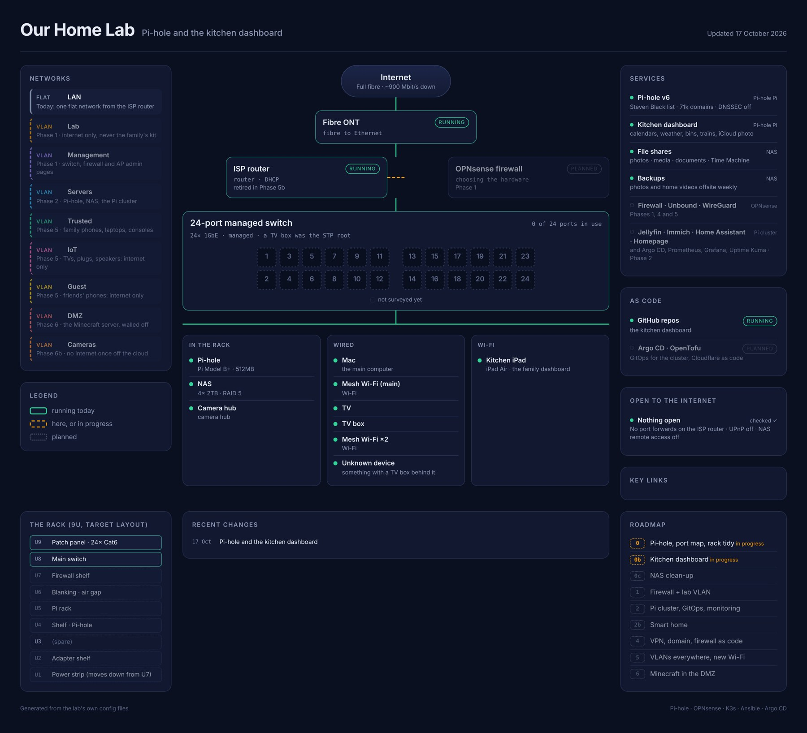
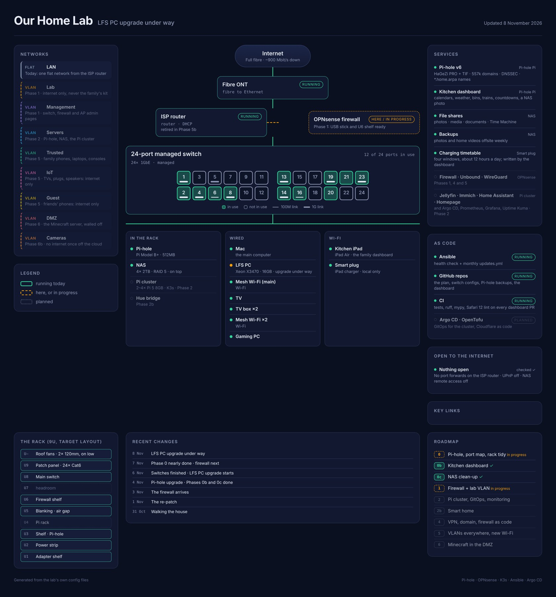

# Phase 0 done: the whole lab on one page

Phase 0 was about getting the kit we already had under control before building anything new. With the rack tidied, it's done, so here's the whole lab on one page: a poster that draws itself from the lab's own config files, and can redraw any day since we started.

<!-- more -->

## What Phase 0 covered

- [Pi-hole on the 2012 Raspberry Pi](pi-hole-on-a-2012-raspberry-pi.md), blocking ads and trackers for the whole house.
- [The kitchen dashboard](kitchen-dashboard-on-an-ios-12-ipad.md) on an old iPad stuck on iOS 12.
- [Tidying up the NAS](tidying-up-the-nas.md): locked down, health checks on, half its space back.
- [The photos](photos-50000-duplicates-and-20-years-sorted.md): 50,000 duplicates set aside and 20 years sorted by date.
- [The documents](documents-7000-files-down-to-540.md): nearly 7,000 files down to about 540.
- [The rack tidy](tidying-the-rack.md): shelves, roof fans and room for the firewall.

One part never got a post of its own: mapping the cabling. The switch got a health check, every wall socket was traced back to its port on the patch panel, three broken cables turned up, and the patching was redone so the numbers on the panel and the switch match. It's not very exciting to read about, but every later phase depends on it.

## The poster

People on r/homelab often share a one-page "my homelab" poster: the network, the kit, the services, all on one sheet. We wanted one too, but a drawing goes out of date the moment something changes, so ours is **generated**.

Two files in the lab's repo describe everything. One lists the networks, the kit, the services, the rack, the roadmap and what's open to the internet, and marks each thing as **running**, **here or in progress**, or **planned**. The other is the map of the switch's ports from the cable survey. A script turns the two into a web page and a picture. Running things get a solid green outline, things in progress a dashed orange one, and planned things a faint dotted one. So you can see at a glance how much of the plan is real.

When the lab changes, we update the file and run the script, in the same commit as the change itself. The poster can't drift out of date, because there's nothing to redraw by hand.

## Drawing any day since we started

Every change in that file has a date: when something arrived, when it went live, when it moved. So the script can draw the lab **as it was on any day**, not just today. For the switch's ports, it digs the port map out of the repo's history as it stood that day.

Each day that something happened also gets a one-line headline. Put together, they're the story of Phase 0 so far:

- **17 Oct:** Pi-hole and the kitchen dashboard
- **23 Oct:** the NAS clean-up begins
- **25 Oct:** the firewall is ordered
- **27 Oct:** everything goes into git
- **30 Oct:** the port survey
- **31 Oct:** walking the house, socket by socket
- **1 Nov:** the re-patch
- **3 Nov:** the firewall arrives
- **4 Nov:** a Pi-hole upgrade, and the dashboard and NAS phases finished
- **6 Nov:** the switches finished, and work starts on the old desktop
- **8 Nov:** the rack tidy done

<figure markdown>
{ loading=lazy }
<figcaption>17 October. Pi-hole and the dashboard are running, the firewall is still a plan, and none of the switch's ports have been surveyed.</figcaption>
</figure>

<figure markdown>
{ loading=lazy }
<figcaption>8 November, the end of Phase 0. Every port is mapped, the firewall has arrived, and the rack matches the plan.</figcaption>
</figure>

My favourite detail is on the first one. The switch line says "a TV box was the STP root". STP (spanning tree) is how network switches agree on a layout without loops, and one device gets elected as the root that everything else measures from. Ours had quietly elected a TV box. Our main switch has been in charge since 30 October.

## The version we can share

Our own copy of the poster has everything on it: addresses, the internet provider, makes and models, which room each socket is in, and what's on every port. That's handy for us, but it's not something to put on the internet.

So the same script draws a **public version**, which is the one in this post. It leaves out addresses and network numbers, swaps makes and models for plain names ("ISP router", "24-port managed switch"), groups the kit by how it's connected rather than by room, shows the switch's ports only as in use or not, and keeps each day's headline rather than the detail.

It also has a list of things that must never appear, such as brand names, rooms, first names and anything that looks like an address. If any of them is still on the page, the script stops and draws nothing. That's caught things already. When we added a panel showing how full each disk is, the public version started showing the NAS's fill level, so now it leaves that panel out.

## How it was made

The script was written with Claude Code, from a description of the posters we liked and what we wanted on ours. Adding the history, then the public version and its safety list, came later as separate requests. Keeping it current is now part of the lab's rules: whatever changes, the poster changes in the same commit.

## Where it's up to

Phase 0 is done, apart from one small job: the temperature probe in the rack, which my son is wiring up. From here, an updated poster will close each phase's last post, so you can watch the dotted boxes turn green.

## What it cost

Nothing.

## What's next

The old desktop PC: brought back to life, and given a new job.
