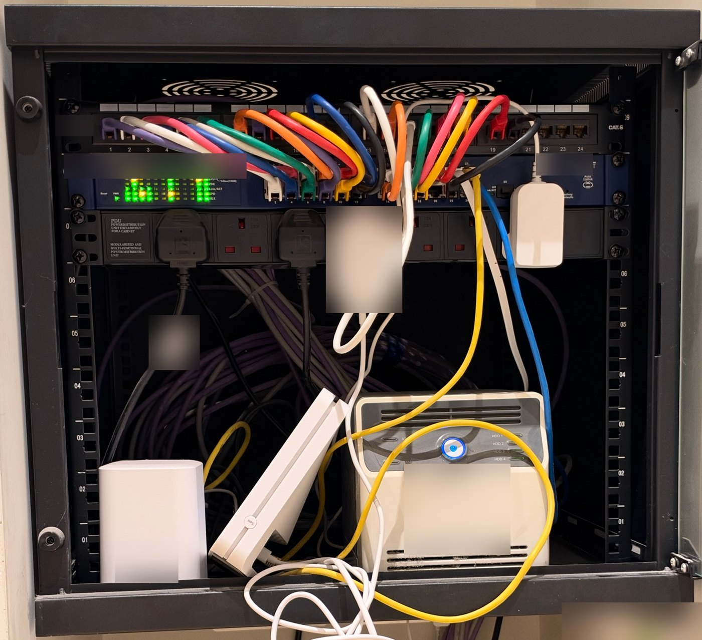
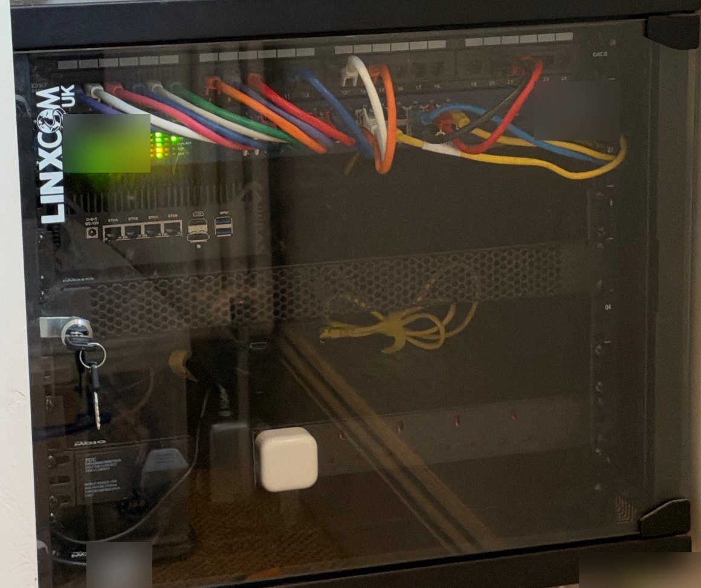

# Tidying the rack

Every cable in our house ends up in a small 9U wall cabinet in an alcove, with a glass door, on show in the room. By the start of November it was a mess: kit sitting on the floor of the cabinet, plugs hanging down over everything and cables trailing out onto the carpet. Over about a week I sorted it out, and made room for the firewall that's coming next.

<!-- more -->

My younger son came and helped with this one.

## Before

<figure markdown>
{ loading=lazy }
<figcaption>Before, on 1 November. Brand labels and stickers are blurred.</figcaption>
</figure>

The patch panel and switch at the top were fine. The trouble started underneath. The power strip sat straight under the switch with its sockets facing forward, so the plugs and bulky adapters hung down over everything below. The NAS, the internet router and a camera hub sat on the cabinet floor, surrounded by power adapters, the spare length of the house cables and patch leads going everywhere. The floor of the cabinet had basically become a pile.

## The plan

Before buying anything, I wrote down what should go in each of the nine slots (rack units, or U), from the bottom up:

- **U1:** a shelf for power adapters
- **U2:** the power strip
- **U3:** a shelf for the Pi-hole Pi
- **U4:** empty, for a Pi rack later
- **U5:** a vented blanking panel, as an air gap
- **U6 and U7:** a shelf for the firewall
- **U8:** the switch
- **U9:** the patch panel

The firewall changed things. It arrived on 3 November, earlier than expected, and it's about 6cm tall. One rack unit is 4.4cm, so it needs the height of two. Its shelf moved down to make room, and the lesson went into the notes: **check every new box's height against 4.4cm before buying it.**

## Moving things out

The first step was clearing space. The NAS came out of the cabinet and went on top of it, plugged into the wall sockets above rather than the rack's power strip. The router went up there too. It's too deep to stand on a shelf and too tall on its side to fit alongside anything else, and it's being retired once the firewall takes over anyway. The camera hub moved to a spare network port on one of the mesh Wi-Fi points.

At the same time the patching got sorted out. Up to then it had grown by accident: the patch panel and switch numbers stopped matching after port 19, and the rack's own kit sat on whatever port happened to be free. Now every house cable uses the switch port with the same number as its panel port, and the kit inside the rack has its own block of ports on short runs straight into the switch. One broken wall cable found in the survey was re-punched and works again.

## Shelves, and a power strip that fits

The shelves went in over two days.

**The power strip went in upside down, the first time.** The plan had the strip at the very bottom (U1) with the adapter shelf above it. Once it was in, the bottom of the cabinet sat right under the sockets, and big UK plugs just wouldn't go in. The next day I swapped them round: the strip at U2, the adapter shelf at U1 underneath, with the adapters lined up on it.

Then came the shelf at U3 for the Pi-hole, the blanking panel at U5, and the firewall's shelf at U6. The firewall was test-fitted on its shelf, with room above for the small fan on its top. Last of all, the power leads were run up the back corners and velcroed to the rails, with the slack of the house cables bundled at the back.

## Fans in the roof

A closed glass door and a firewall on the way means heat. The cabinet's roof has two round grilles, so I hung a pair of quiet 120mm USB fans under them, inside the cabinet. The fans have no screw holes, so each one hangs on velcro ties threaded up through one slot in the grille and back down through the next. They blow upwards, pulling warm air out of the roof, while cool air comes in through the side vents. They sit behind the patch panel, so you can't see them at all.

It was fiddly, but they work. For now they run on low all the time, powered from a USB charger on the strip.

## After

<figure markdown>
{ loading=lazy }
<figcaption>After, on 8 November, with the door shut. Brand labels and stickers are blurred.</figcaption>
</figure>

The door shuts, the cabinet floor is clear, and the firewall has a home.

One tip if you're photographing your own: a glass door reflects the whole room. Switch off the lights opposite and shoot at a slight angle, or just open the door.

## Where it's up to

Nearly done. Still to do:

- **A temperature probe.** A small probe near the roof, wired to the Pi-hole Pi, so we can see how warm the cabinet gets with the door shut. That one's my older son's job. Once there are readings, we'll decide whether the fans need to run all the time.
- **The firewall** goes in properly in the next phase.

## What it cost

**£107.55,** in one order: three shelves, a vented blanking plate, cage nuts to fix them, the roof fans, velcro ties, edge trim for the cable hole in the roof and a pair of temperature probes. That includes a pack of bolts for the fans that turned out not to be needed, since the fans have no screw holes. The power strip and the USB charger for the fans were already here.

## What's next

The firewall: the first proper piece of the lab, and the point where the house stops relying on the internet provider's router.
